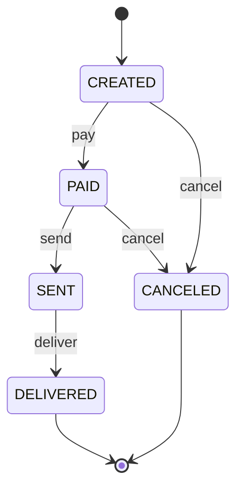

# Order Lifecycle API

API REST para gerenciar o ciclo de vida de pedidos, desenvolvida com **Java e Spring Boot** para o desafio final de **Padrões de Projeto (Design Patterns)**.

Um pedido passa por estados bem definidos, e cada estado só permite certas ações. O projeto aplica três padrões: **Builder**, **State** e **Observer**.

## Tecnologias

- Java 21
- Spring Boot (Web, Data JPA)
- H2 (banco em memória)
- Maven

## Ciclo de vida do pedido



Qualquer transição fora desse diagrama retorna **409 Conflict**.

## Endpoints

| Método | Rota | Descrição | Respostas |
|---|---|---|---|
| POST | `/orders` | Cria um pedido | 201, 400 |
| GET | `/orders` | Lista os pedidos | 200 |
| GET | `/orders/{id}` | Busca um pedido | 200, 404 |
| PATCH | `/orders/{id}/pay` | Paga o pedido | 200, 404, 409 |
| PATCH | `/orders/{id}/send` | Envia o pedido | 200, 404, 409 |
| PATCH | `/orders/{id}/deliver` | Entrega o pedido | 200, 404, 409 |
| PATCH | `/orders/{id}/cancel` | Cancela o pedido | 200, 404, 409 |
| GET | `/orders/{id}/history` | Histórico de status | 200, 404 |

Exemplo de corpo do `POST /orders`:

```json
{
  "name": "João",
  "email": "joao@email.com",
  "address": "Rua A, 123",
  "observation": "Entregar à tarde"
}
```

## Padrões de projeto aplicados

### Builder: criação do pedido
**Problema:** montar o `Order` com vários `set...` permitia objetos incompletos ou inválidos.
**Solução:** o `OrderBuilder` valida os campos obrigatórios (nome, e-mail e endereço) e define o status inicial e a data de criação no `build()`. Toda criação passa pela mesma regra.
**Onde:** `domain/OrderBuilder`, usado pelo `OrderService.create`.

### State: transições de status
**Problema:** cada endpoint de transição repetia `if/else` sobre o status atual, e qualquer regra nova exigia mexer em vários lugares.
**Solução:** cada estado é uma classe que sabe quais ações permite. As ações não permitidas lançam `InvalidOrderTransitionException`, traduzida para 409. O `Order` apenas delega ao estado atual, e o enum `OrderStatus` guarda a instância de cada estado. O banco grava só o texto do enum.
**Onde:** pacote `state` (`OrderState`, `CreatedState`, `PaidState`, `SentState`, `DeliveredState`, `CanceledState`).

### Observer: histórico de mudanças
**Problema:** registrar o histórico dentro do service o deixaria acoplado a tudo que precisa reagir a uma mudança de status.
**Solução:** o `OrderService` publica um `OrderStatusChangedEvent` a cada transição bem-sucedida, e o `OrderHistoryListener` (`@EventListener`) grava o histórico. Novos observadores (e-mail, log, métricas) podem ser adicionados sem alterar o service.
**Onde:** pacotes `event` e `listener`.

## Estrutura do projeto

```
src/main/java/onedigitalinnovation/lab
├── controller   → camada HTTP
├── service      → regras de aplicação e publicação de eventos
├── domain       → entidades, enum e builder
├── state        → implementação do padrão State
├── event        → eventos do padrão Observer
├── listener     → observadores dos eventos
├── repository   → acesso a dados (Spring Data JPA)
└── dto          → objetos de entrada e saída da API
```

## Como executar

```bash
git clone https://github.com/jvuchoa/order-lifecycle-api.git
cd order-lifecycle-api
./mvnw spring-boot:run
```

A API sobe em `http://localhost:8080`.

## Evolução do projeto

O histórico de commits mostra a refatoração em etapas: primeiro uma versão simples com `if/else`, depois a aplicação de cada padrão (Builder, State e Observer).

## Possíveis melhorias

- Testes unitários dos estados e testes de integração do fluxo
- `@RestControllerAdvice` para centralizar o tratamento de erros
- Documentação com Swagger (springdoc)
- Banco relacional persistente (PostgreSQL)